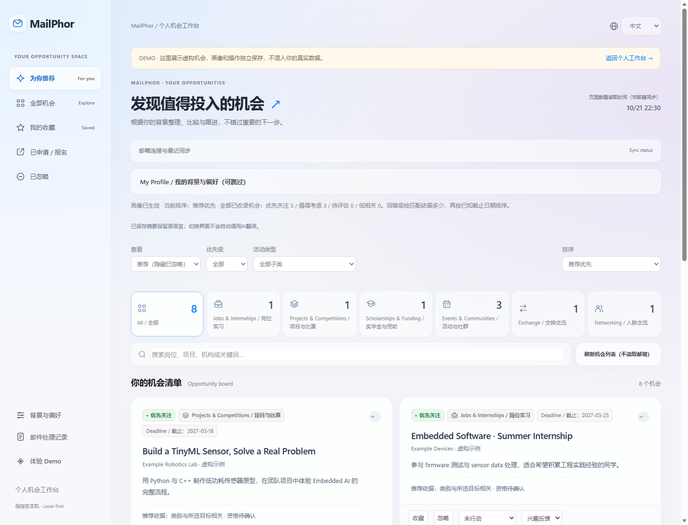

# MailPhor

> Portfolio prototype · local-first · single-user

**A local-first campus opportunity radar.** 从学校邮件中提取机会，结合个人偏好排序，并保留能核对的原文与行动清单。



### Try the demo — no account or API key

```powershell
python app.py --mode serve
```

Open [the synthetic Demo](http://localhost:8000/index.html?demo=1). Demo data and browser state are separate from personal mail. The UI uses local CSS and JavaScript with no CDN dependency.
Python 3.11+ is the intended baseline; current verification ran on Windows/Python 3.14. Node and Edge are only needed for browser test/capture tooling, not normal use.

### What works

- Read-only IMAP, UID/UIDVALIDITY cache, forwarding-source filters and bounded batches.
- Digest-to-multiple-opportunities extraction, evidence checks, deadlines, checklists and conservative deduplication.
- Optional profile, explainable local matching, separate qualification warnings; sports and societies are valid interests.
- Bookmarks, ignored/applied views, persistent checklist progress, filters and ordering.
- Processing audit, per-attempt diagnostics, explicit reanalysis queue and same-origin local sync controls.
- Responsive, system-app-inspired dashboard and an isolated synthetic Demo.

### Why this is a useful engineering project

MailPhor addresses a real information-loss problem: important opportunities are mixed with routine university mail and forwarded digests. The project separates source facts from personal recommendations, preserves evidence for manual checking, and treats AI/network failures as retryable states instead of silently discarding messages.

### Demo and verification

The public Demo uses synthetic opportunities only and does not connect to a mailbox or AI provider. The current local MVP has 50 Python regression tests, JavaScript checks for personalization/audit/i18n behavior, and an isolated browser test covering profile ranking, saved actions, checklist persistence, sync controls and language switching.

The real AI provider is user-configurable. Free model routers can be rate-limited or select unsuitable models; the application records the failure, cools down the message and keeps it available for retry. Overall extraction accuracy has not been measured on a complete 20-message reference set.

### Scope and evidence

[Product requirements](PRD.md) · [Progress](IMPLEMENTATION.md) · [Architecture](docs/ARCHITECTURE.md) · [Acceptance evidence](docs/ACCEPTANCE.md) · [Demo / user checklist](docs/DEMO_GUIDE.md) · [CV notes](docs/CV_NOTES.md)

This is a personal MVP, not a production multi-user service. Recommendation is rule-based, not an AI eligibility guarantee. A 12-role digest succeeded in one isolated real-model check; overall accuracy/recall has not been measured on a complete reference set.

## Product implementation status

The confirmed scope is in [PRD.md](PRD.md); progress and limitations are in [IMPLEMENTATION.md](IMPLEMENTATION.md).
This is a working prototype with a local profile questionnaire, explainable rule-based ranking, qualification warnings, and persistent favorites/application/checklist state. It is not a completed AI eligibility assessor. Full real-mail acceptance remains pending.
Existing email cards are not automatically reanalysed. Sports and student organisations are valid opportunities; relevance will depend on user preferences.
The local HTTP server only serves the dashboard and opportunity data, not credential files.

## Current scope

- Any IMAP mailbox with an app password or authorization code; QQ is the currently tested setup
- Local JSON storage during the MVP
- AI classification and structured opportunity cards
- Search, category filters, deadlines, checklists and copyable summaries
- Optional Telegram notifications

Microsoft Outlook direct login is intentionally not part of the MVP. The university mailbox can forward selected mail to any private IMAP mailbox; MailPhor never needs the university password. Gmail, Outlook personal mail, QQ and other IMAP providers can use the same ingestion path, subject to their provider's IMAP/OAuth rules.

## Run locally

To inspect the dashboard without reading email or calling AI, run `python app.py --mode serve`.
At `/mail-audit.html`, the diagnostic preview button shows simulated examples in memory only. Refresh returns to real records; examples do not validate cloud AI availability.

Open My Profile to save optional background, goals and interests. The known-background button only prefills EE/Year 2/C++/Python; it does not save or choose interests for you.
Personal settings stay in localStorage for this browser and origin, not in Git or cloud AI. Clearing site data or changing browser/port loses access to that local state. Unknown qualification conditions remain unconfirmed; current ranking is rule-based, not AI deep review.
The list refresh button reloads saved opportunity data; it does not fetch new email. Use the explicit sync controls in the status panel or run once/watch for actual mailbox sync. Turning off periodic sync lets the current batch finish.
Mailbox sync summaries are saved separately in sync_status.json and shown on the dashboard. The default batch size is five; MAX_EMAILS_PER_RUN can configure 1–50. Successful messages use a mailbox-specific IMAP UID/UIDVALIDITY cache alongside legacy Message-ID history.

Checks: `python -m unittest test_mailphor_validation test_ai_process_integration`, `node test_personalization.cjs`, `node test_audit_page.cjs`, and `python test_dashboard_browser.py` (isolated local Edge with synthetic data). `python capture_demo.py` regenerates only public synthetic desktop/mobile screenshots.

1. Enable IMAP and create an app password/authorization code for your chosen mailbox provider.
2. Copy `config.local.example.json` to `config.local.json` and fill in your local credentials. Environment variables can also override the JSON values.
3. Install Python 3.11+.
4. Choose an AI provider in `config.local.json` or environment variables. For a cloud provider, set `AI_API_KEY` and `AI_MODEL`; the older `DEEPSEEK_API_KEY`/`DEEPSEEK_MODEL` names remain supported. For any OpenAI-compatible service, set `AI_PROVIDER`, `AI_BASE_URL` and `AI_MODEL`, for example `AI_PROVIDER=ollama`, `AI_BASE_URL=http://127.0.0.1:11434/v1`, `AI_MODEL=qwen2.5:7b`. Local Ollama/LM Studio can use a placeholder key such as `ollama`; no cloud balance is required. Run `python app.py --mode test-ai` to verify the selected model without reading mail, then use `python app.py --mode once` for one sync or `python app.py --mode watch` for polling. Free cloud routers may still be rate-limited or select unsuitable models, so explicit tested models are recommended.
5. Open `http://localhost:8000/index.html`.

The demo mode can be used without an email account while developing the UI. Never commit `config.json`, API keys, mailbox passwords, authorization codes or Telegram tokens.
The HTTP server is for localhost use only; it has no public account authentication. Do not port-forward it as a public service. Mail contents selected for cloud extraction are sent to the configured model provider; personal profile/actions stay in this browser. The planned hosted version needs a real backend, authentication, encrypted per-user secrets and a database; uploading this local server directly is not a safe deployment.
`init-sample` is a legacy helper and refuses to overwrite an existing non-empty opportunity file. Prefer the isolated Demo URL for presentation.

## Resume angle

The project demonstrates MIME email parsing, read-only IMAP ingestion, UID/UIDVALIDITY caching, deduplication, LLM information extraction, evidence validation, deadline detection, explainable prioritization and failure-aware notification automation.
