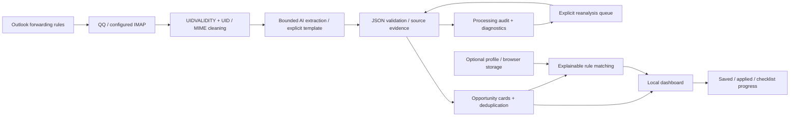

# Architecture / 技术架构

MailPhor is a local-first single-user application. Python standard-library services ingest read-only IMAP mail and call an OpenAI-compatible model endpoint. The browser presents opportunities and stores personal preferences separately.

## Boundaries

- `app.py`: CLI, local HTTP allowlist, same-origin action endpoints, IMAP UID reading, extraction validation, atomic JSON storage, audit trail, bounded retries, sync controller.
- `personalization.js`: deterministic recommendation and qualification warnings, browser storage, date ordering. It does not call AI.
- `index.html` and `styles.css`: dependency-free local UI, profile, filtering, saved views, checklist, sync controls. Demo state uses a separate storage key.
- `mail-audit.html`: observable negative classifications, failures, diagnostics and an explicit queue action.
- `demo.json`: public synthetic opportunities, never loaded into the personal data file.

## Reliability choices

Requests execute in spawned processes. At the total deadline the local process is terminated and joined; that cannot refund or guarantee cancellation of work already running at the provider. Each extraction call makes at most two requests. Digest output budgets are capped, and truncation can increase the single retry budget.

UID caching is scoped to host/account/folder/UIDVALIDITY. Legacy Message-ID history remains supported. A processed UID is saved only after successful extraction, deduplication or explicit negative classification. Deferred mail is kept for retry.

Opportunity identity includes category/title/organization, cutoff and session time/link. This is conservative rule deduplication, not semantic equivalence. Old cards are not destructively migrated.

Evidence quotes and URLs are checked against provided text. This does not prove the model interpreted a date correctly. The reader bounds message size, skips full attachment processing, and marks potentially incomplete content.

## Data separation

Private files, ignored by Git: configs, opportunities, audit, state, retry queue, sync summary. Public assets: synthetic Demo and screenshots.

Browser-local profile/actions are not sent to the model. Clearing site storage or changing browser/origin loses access to that local state. The copy-context action deliberately includes the profile only when the user requests the copy.

HTTP binds to localhost; it is not a production multi-user server. The static allowlist blocks configuration, source and backup paths. Mutating endpoints require JSON and same-origin requests with a local Host. Do not expose this unauthenticated personal server to the public internet.

## Tradeoffs to explain in an interview

- Forwarding is a pragmatic workaround for institutional authentication; forwarding filters can miss mail before MailPhor receives it.
- Facts are extracted once; changing a profile recalculates recommendations locally without model cost.
- Simple explainable rules provide inspectable matching; they do not replace a deep eligibility review.
- Local JSON and browser storage minimize setup, but do not support cross-device synchronization or distributed use.
- Template extraction is restricted to an explicit observed Canvas signup format; other content still uses the model and can fail.
